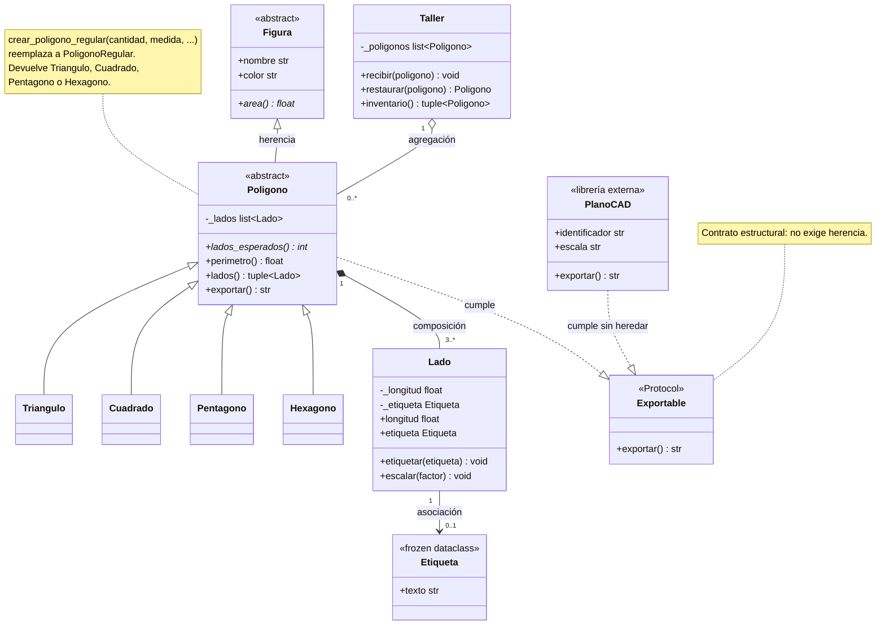

# Diagrama UML final — TP Integrador POO

## Decisiones reflejadas

- `Figura` y `Poligono` son abstractas: `area()` y `lados_esperados()` son
  obligatorios. Instanciar `Poligono` falla al construir.
- `Poligono` compone sus `Lado` (los copia en el constructor) y `lados()`
  devuelve una tupla, no la lista interna.
- `Taller` agrega polígonos ya construidos; `inventario()` devuelve una tupla.
- `Lado` tiene una asociación opcional con `Etiqueta`; no la crea.
- `PoligonoRegular` no aparece como subclase: fue reemplazada por la fábrica
  `crear_poligono_regular()`.
- `Exportable` es un `Protocol`; `PlanoCAD` lo cumple sin heredar ni modificarse.
